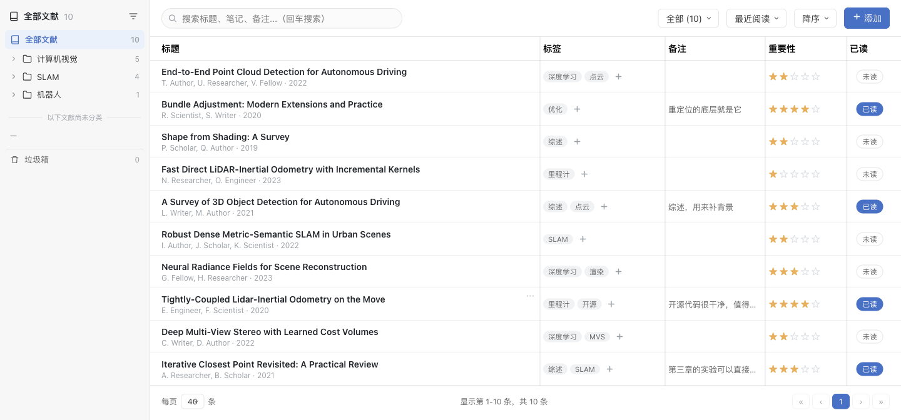
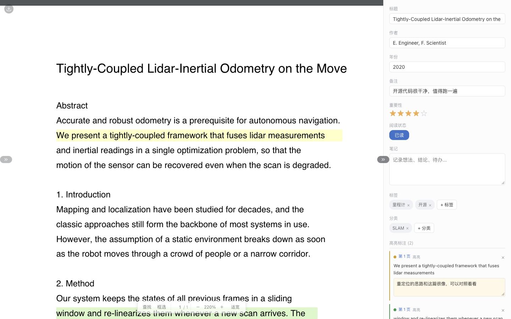
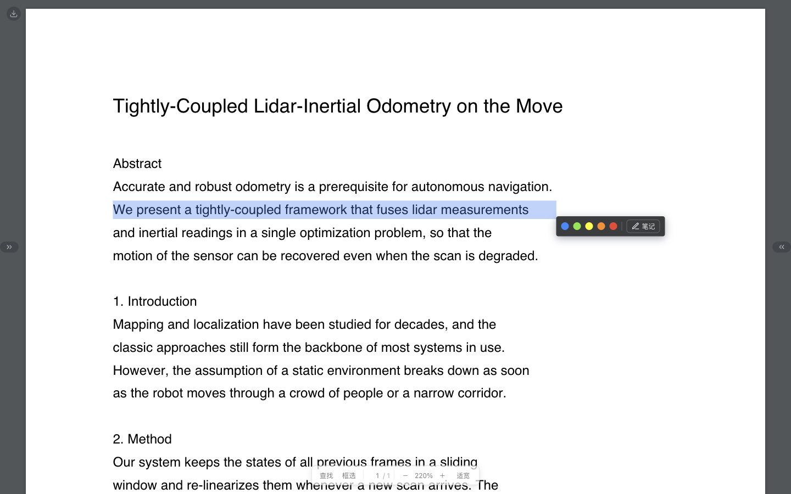
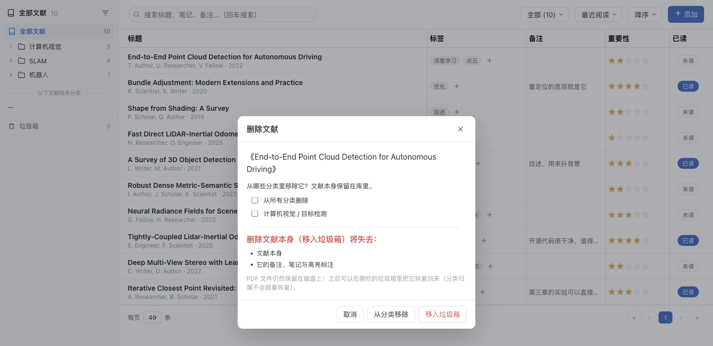

# Paper Reader · 本地文献库

仿照 [readpaper](https://pay.readpaper.com/home/library) 的交互做的**本地平替**：数据全部留在自己机器上，可通过 Docker 一键部署的论文管理与阅读服务。

- **后端** Python + FastAPI + SQLite（uv 管理依赖）
- **前端** 原生 JS + pdf.js（由 FastAPI 直接托管，镜像中无需 Node）
- **数据** 可直接导入 readpaper 官方导出的 `data.json` + `pdfs/`（分类树、标签、备注、重要性、高亮标注全部保留）
- **许可证** [MIT](LICENSE) —— 什么人都能用：自由使用、复制、修改、合并、商用、再分发（含闭源商用），唯一义务是保留版权和许可声明

```
┌─────────────────────────────────────────────────────────────┐
│ 侧边栏: 分类树 / 标签 / 未分类        主区: 搜索 · 排序 · 添加      │
│                                          列表: 标题 标签 备注 星级 │
├─────────────────────────────────────────────────────────────┤
│ 阅读页 /paper/<id>（独立页面）: pdf.js 渲染 + 高亮覆盖层           │
│                          |  元信息 / 笔记 / 标签 / 分类 / 标注     │
└─────────────────────────────────────────────────────────────┘
```

## 截图

> 截图里的文献库是**为了拍照临时造的**（`make screenshots` 会起一个临时目录、
> 临时服务和临时浏览器），标题和备注都是编出来的，不是谁的真实文献库。

**文献库**：左边是分类树，右边一行一篇 —— 标题、标签、备注、星级、已读状态都能就地改。



**阅读页**：pdf.js 渲染，右侧是元信息、笔记、标签、分类和高亮标注。



**选中文字**后浮出工具条：五个颜色 + 写想法，悬停时选区会先预览那个颜色。



**删除时**可以选：只把它移出某几个分类（文献本身留在库里），或者整个移进垃圾箱。



## 目录结构

```
paper_reader/
├── backend/            FastAPI 服务
│   ├── app/
│   │   ├── main.py       应用入口 + 静态前端托管
│   │   ├── config.py     环境变量配置
│   │   ├── db.py         SQLite schema 与查询
│   │   ├── importer.py   readpaper 导出导入器
│   │   ├── cli.py        命令行工具
│   │   ├── hashes.py     文件哈希与查重
│   │   ├── trash.py      垃圾箱：删除 → 回收 / 恢复 / 彻底删除
│   │   └── routers/      papers.py / library.py / trash.py
│   ├── tests/          后端测试（pytest，跑在临时数据上）
│   └── pyproject.toml
├── frontend/           前端（无构建步骤）
│   ├── index.html      文献库页
│   ├── reader.html     独立阅读页 /paper/<id>
│   └── static/{app.js, reader.js, common.js, pdfview.js, styles.css, vendor/}
├── tests/e2e/          浏览器测试（真实 Chrome，跑在临时数据上）
│   ├── harness.py        起服务 / 播种数据 / 驱动 Chrome 的公共部分
│   ├── run.py            运行器
│   └── cases/            每个用例一个文件
├── tools/              辅助脚本
│   └── make_screenshots.py  拍 README 用的截图（`make screenshots`）
├── docs/screenshots/   README 里的图片
├── local_data/         数据根目录（唯一的数据存放处）
│   ├── data.json        readpaper 导出的原始数据（只读）
│   ├── pdfs/            全部 PDF：导入的放 pdfs/<id>/，上传的放 pdfs/ 根下（可写）
│   └── db/library.db    SQLite 数据库
├── Dockerfile
├── docker-compose.yml
├── Makefile
└── CLAUDE.md          给 AI 协作者的准则（改动 local_data 前必须先确认）
```

> `local_data/` 里是你自己的文献库，属于不可再生数据。任何会写入或删除其中内容的改动
> （改数据库、重新导入、删 PDF）都必须先确认，并说明改动范围、影响以及能否恢复。
> 这条准则也写在 [CLAUDE.md](CLAUDE.md) 里，AI 协作者会自动遵守。

## Docker 部署（推荐）

前置条件：本机已安装 Docker 与 Docker Compose。

```bash
# 1. 构建镜像并启动（默认 http://localhost:8080）
make docker-build
make docker-up

# 2. 首次运行时导入 readpaper 数据（容器内执行）
docker compose exec paper-reader python -m app.cli import /data/data.json

# 3. 查看日志 / 停止
make docker-logs
make docker-down
```

也可以在浏览器打开 `http://localhost:8080`，点击右上角 **添加** 手动录入。

> 端口可改：`PORT=9000 make docker-up`。

> ⚠️ **默认没有登录验证。** 服务监听在 `0.0.0.0:8080`，也就是说同一个 Wi-Fi 下的
> 别的设备可以直接访问这个服务，也能直接调接口把你的文献删进垃圾箱。只在自己
> 机器上用的话，把 `docker-compose.yml` 里的 `ports` 改成
> `"127.0.0.1:${PORT:-8080}:8080"`（只绑回环地址），或者前面加一层带认证的反向代理。
> 详情见[已知限制](#已知限制)。

### 挂载说明

所有数据都在宿主机 `./local_data` 下，容器内挂到 `/data`：

| 容器路径 | 来源 | 权限 | 用途 |
| --- | --- | --- | --- |
| `/data` | `./local_data` | 可写 | 数据根目录（PDF 库 + 数据库） |
| `/data/data.json` | `./local_data/data.json` | 只读（嵌套挂载） | 导入源文件 |

PDF 在数据库中以相对 `PDF_ROOT` 的路径保存（如 `pdfs/<id>/<file>.pdf`），所以导入的文件零拷贝。

**PDF 只存一份**：`local_data/pdfs/` 是唯一的 PDF 库，导入的放 `pdfs/<id>/` 里，你自己上传的放 `pdfs/` 根目录；一篇文献无论被多少个分类引用，磁盘上都只有一个文件。分类是"虚拟"的（`paper_folders` 多对多表），删掉一个分类时，其它分类还引用着的文献会保留，只有这个分类独占的文献会先进入**垃圾箱**（见下），彻底删除时才会连同 PDF 一起从磁盘移除。

## 本地开发（不用 Docker）

```bash
cd backend
uv sync                       # 创建 .venv 并安装依赖
uv run python -m app.cli import ../local_data/data.json   # 导入数据
uv run uvicorn app.main:app --reload --port 8080
```

浏览器访问 http://127.0.0.1:8080 。

常用命令：

```bash
make help        # 列出全部命令
make import      # 导入（增量，重复导入不会产生副本）
make import-reset  # 清库后重新导入（**连垃圾箱一起清空**）
make stats       # 查看各表行数
make index-hashes  # 给已有的 PDF 补算哈希（上传去重用），只写哈希列，不删任何东西
make colors      # 看有多少条高亮能找回 readpaper 里的颜色（不加 --apply 不写库）
make test        # 后端测试（pytest）
make test-e2e    # 浏览器测试（真实 Chrome）
make lint        # ruff 检查
```

## 测试

两套测试都跑在**临时数据**上：`local_data/` 里是你自己的文献库，测试一行都不碰
（后端测试与浏览器测试都会先检查数据目录，发现指向 `local_data/` 直接报错退出）。

```bash
make test           # 后端：pytest，58 个用例，秒级完成
make test-e2e       # 浏览器：真实 Chrome 驱动真实页面
make lint           # ruff
```

**后端测试**（`backend/tests/`）用 `pytest` + `TestClient`，每个用例前把数据库和
PDF 目录清空：`test_papers.py`（上传 / 查重 / 修改）、`test_hashes.py`（哈希与重复
判定）、`test_importer.py`（readpaper 导出导入）、`test_trash.py`（删除 / 恢复 / 彻底
删除）、`test_library.py`（分类树、标签、筛选、排序、分页、统计）、
`test_annotations.py`（标注的颜色、坐标、想法与删除）。

**浏览器测试**（`tests/e2e/`）通过 Chrome 的 DevTools 协议驱动真实页面：自己起一个
后端进程（`PDF_ROOT` / `DATA_DIR` 指向临时目录）、自己播种一份小文献库、用完删掉。
覆盖：列宽拖动与双击复位、标题改名菜单、标签弹窗（加已有标签、新建标签、去掉标签、
侧栏跟着更新）、备注就地编辑、列表没有多选、已读要确认、标题才打开阅读页、右键菜单
删除进垃圾箱并恢复、上传重复文件弹出「这篇已经在库里了」、添加窗口没有「链接 / 标题」
且必须选文件；阅读页还有：角落里的下载按钮、信息侧栏开合、底部工具条、页码随滚动更新、输入页码跳转、
缩放控件、左侧目录抽屉（点条目跳章）、全文查找（命中高亮、计数、Esc 关闭）、在 PDF 里选中文字
划出彩色高亮（五色工具条、悬停预览颜色）、写想法、框选一个区域、删除标注。

浏览器测试需要 Chrome 开一个调试端口：

```bash
/Applications/Google\ Chrome.app/Contents/MacOS/Google\ Chrome \
  --remote-debugging-port=9333
make test-e2e                  # 跑全部
make test-e2e CASE=duplicate   # 只跑一个用例
```


## 功能说明

**文献库**
- 右上角 **添加**：上传一个 PDF —— 拖一个文件进来或点开文件选择器；再补上标题、分类、标签（逗号分隔）即可。上传走流式写盘，超过 `MAX_UPLOAD_MB`（默认 200 MB）会被拒绝并提示；作者、年份、备注等字段到阅读页里再补。**文献必须有文件**：不传文件会被后端拒绝（400），没有文件也就没有哈希
- **上传去重**：上传时按文件内容的 sha256 判重，命中已经存在的文献就**不再添加**，弹窗告诉你那篇的标题和分类（完整路径），刚传上来的文件也会立刻删掉，磁盘上不留副本。判定只看**库里**的文献：垃圾箱里的文件是可以再传一次的
- **每一篇文献都有哈希**：哈希是文件内容的指纹，只在三种情况下写入 —— 上传时（边传盘边算）、`make import` 导入时、`make index-hashes` 补算。之后不会再变，因为应用从不改写 PDF；删除文献时哈希跟着行一起走，垃圾箱里留一份，恢复时一起带回来
- 左侧分类树（支持多级嵌套，父分类计数含子分类）与标签筛选
- 分类的身份是**路径**而不是名字：同名分类可以存在于不同父分类下（如 `CV / 点云 / 地图` 与 `SLAM / 点云 / 地图`），因此阅读页的分类、删除/重命名弹窗一律显示完整路径（文献列表的「标签」列只放标签，不混入分类）
- 选择分类的弹窗（阅读页「添加分类」）宽度加倍，弹窗里的分类树默认折叠，点分类名逐级展开 / 收起；已经勾选的分类会自动展开到可见，重名的额外标出父分类
- 分类树可展开 / 折叠：点分类前面的箭头展开子分类和该分类下的文献标题（点分类名则是按该分类筛选主列表）；点文献标题在**新标签页**打开阅读页，当前列表不跳转
- 分类右键（或点分类名右侧的「⋯」）弹出菜单：**重命名**、**添加子文件夹**、**删除分类**
- 删除分类前会弹出确认窗口，明确列出将失去的内容（分类本身、子分类、只有它独占的文献）；这些文献会先进入**垃圾箱**，不是直接消失；其它分类还引用着的文献会保留
- **拖拽**：把分类拖到另一个分类上＝变成它的子分类（拖到「全部文献」上＝移回顶层）；把文献拖到分类上＝加入该分类；把文献拖到「以下文献尚未分类」＝移出所有分类。拖到自己/自己的子分类上会被忽略
- 侧栏里的文献也能删除：悬停出现垃圾桶按钮，或右键文献弹出菜单（打开阅读页 / 删除文献）；删除前弹窗列出会失去的内容（文献本身、备注笔记与高亮标注），文献随后进入**垃圾箱**，PDF 文件仍保留在磁盘上
- **删除弹窗可以只动分类**：一篇文献可以同时挂在几个分类下，弹窗里把它的分类列成一排 checkbox（带完整路径），勾哪几个就从哪几个分类里移出去 —— **文献本身留在库里**；还有一项「从所有分类删除」，一键把它变成未分类。不想删文献、只想调整分类时用这一半就够了。想真正删掉文献，按「移入垃圾箱」：那会失去文献本身、备注笔记与高亮标注（PDF 仍在磁盘上，垃圾箱里能恢复）
- 侧栏宽度可调：拖动右边缘的手柄调整（160–520 px，双击恢复默认 240 px，宽度会记住）；标题放不下时直接截断显示省略号
- 搜索：标题、作者、备注、笔记、摘要（输入框里敲完按 **回车** 才搜索，输入过程中不会发请求；输入框内容和光标位置在刷新后保留）
- 排序：按字段（最近阅读 / 添加时间 / 更新时间 / 标题 / 重要性 / 已读）+ 方向（升序 / 降序 / 无序）组合；点击表头「标题」「重要性」「已读」可在升序与降序间切换，当前排序方向在表头以 ↑ ↓ 标注
- **列宽可调**：拖动表头上列与列之间的分隔线即可改变该列宽度（双击分隔线恢复默认），每一列都能单独调整，宽度记在浏览器本地；第一次拖动时标题列会从「自动填满」变成固定宽度，之后表格总宽可以超过窗口，横向滚动条可以滑过去
- 列与列之间有一条很浅的分隔线：3 px 宽的竖直浅色带，画在列与列的空隙里（不压到文字），从表头一直贯穿到列表底部、中间不断开；最后一列右边没有线
- **标题列可改名**：在标题上右键（或悬停出现「⋯」按钮）弹出菜单：**修改标题**、**添加分类**、**打开阅读页**、**删除文献**；改完立即保存，列表和阅读页同步（删除走垃圾箱，PDF 留在磁盘上）
- **标签列可改标签**：每行标签后面的「+」打开标签弹窗，输入关键字会**模糊匹配**库里已有的标签（最多列出 20 个，这篇已经带的会打勾），点一下加上、再点一下去掉；回车把输入的名字直接建成新标签
- **备注列可就地编辑**：点备注单元格变成输入框，回车保存、Esc 放弃；空备注在悬停时显示「添加备注」提示
- **只有点标题才会打开阅读页**：在阅读页新标签打开，点标签、备注、重要性、已读等其它列都不会跳转（各列有各列的操作）
- 分页：每页 20 / 40 / 100 条可切换，底栏常驻显示「第 X-Y 条，共 N 条」与页码按钮
- 没有多选 / 批量操作：改名、标签、备注、星级、已读都能在行内就地改；分类在标题右键菜单的「添加分类」里改（也可以把侧栏树里的文献拖到分类上），删除在侧栏右键（后端仍保留 `/api/papers/bulk` 接口备用）
- 星级重要性（0–5），点击循环 0→1→2…
- **标签是派生数据**：一个标签失去了它最后那篇文献，就会跟着消失；但刚建好、还没挂到任何文献上的标签会留着（等着被用）
- **已读状态**（布尔）：列表最右侧有「已读 / 未读」按钮，点击**先弹确认框**（按钮小、容易误触），确认后才切换；阅读页的「阅读状态」按钮同样要确认；顶栏下拉框可只看已读或未读（带数量，数量随切换实时更新）
- 后端不可用时页面不会白屏：显示「加载失败：…」和一个「重试」按钮

**垃圾箱（侧栏底部）**
- 删除文献（单条 / 随分类删除）不会真正消失：文献的元数据整体移入 `trash` 表，**PDF 文件留在磁盘上**
- 侧栏「垃圾箱」入口带实时条数；点开是独立的垃圾箱面板，列出标题、作者、删除时间、占用大小、标注数量
- **恢复**：文献回到「以下文献尚未分类」列表，备注、笔记、高亮标注、标签、重要性一并还原（分类归属不恢复 —— 分类可能已被删除）
- **恢复会被去重拦下**：如果这份 PDF 已经在库里了（删掉后又上传了同一份文件），恢复会返回 409 并提示「这篇已经在库里了：《标题》」，条目仍留在垃圾箱里，可以选择彻底删除
- **彻底删除**：确认窗口列出将失去的内容（元数据 + PDF 文件），确认后才从磁盘删除该文件
- **清空垃圾箱**：一次性删除全部条目及它们的 PDF 文件，需二次确认
- 元数据存放在独立的 `trash` 表里，与 `papers` 表分离；删掉分类时只属于它的文献同样进垃圾箱

**阅读页（独立页面 `/paper/<id>`）**
- 文献库只负责列表；点**标题**跳转到独立阅读页（`frontend/reader.html`），用浏览器的后退键回列表
- 文献打不开时（比如 id 不存在）会显示「无法打开这篇文献：…」和返回按钮，而不是空白页
- pdf.js 渲染，缩放、滚动加载（长论文不会卡）；缩放后仍停在当前阅读位置，不会跳回页首
- **缩放以 10% 为一档**（130% → 140% → 150%），屏幕上永远是整数；**打开时就是「适宽」**（页面正好铺满窗口），「适宽」按钮算出来的也是 10 的整数倍
- **底部有一条工具条**（浮在 PDF 上，鼠标靠近才亮）：查找、框选 ｜ 页码（**可以点进去直接输页码回车跳转**）/ 总页数 ｜ 缩小、缩放百分比、放大、「适宽」
- **左侧有目录抽屉**：点左边中间的长扁按钮（»)打开，把 PDF 自带的书签（大纲）列成一棵树，点条目直接跳到那一章的开头；PDF 没有目录时抽屉里会说明
- **可以全文查找**：点工具条上的「查找」，输入关键词 → 命中的地方在 PDF 上标黄（当前这一处标橙），底下显示「第 n / m 处」，↑ ↓ 翻上下一个，Esc 关掉
- **顶部没有常驻菜单栏**：PDF 占满整个窗口，左上角只有一个小圆钮（⤓），点一下**直接下载**这篇文献（菜单里本来也只有下载这一项，就不绕那一圈了）。阅读页**不提供删除**（在文献列表里右键删除，或用侧栏的垃圾桶按钮）
- **可以自己划重点**：PDF 里的文字是可以选中的（选中后按普通网页那样复制）。选中一段文字 → **选区最后一个字的右下角**浮出一个小工具条（深色小条，和 readpaper 一样）→ 点一个颜色 → 高亮立刻出现。**五种颜色**（readpaper 的那套）各有意思：**蓝=引用 / 绿=肯定 / 黄=重点 / 橙=补充 / 红=疑问、反驳**；把鼠标停在某个颜色上，选区会**当场变成那个颜色**（还没点就已经能看见效果），点「✎ 笔记」还能当场写一句想法
- **可以框选**：工具条上的「框选」按钮（或按框选快捷方式）进入框选模式，在页面上拖一个框（图表、公式、插图）→ 同样浮出颜色工具条，画出来的是一个带边框的色框而不是一片底色
- 右侧信息栏里列着全部标注：颜色点、页码、选中的原文、一个可以写想法的输入框（失焦即保存）和删除按钮；点标注跳回原文那一页
- **点已有的高亮会弹一个小窗**：高亮上出现一个 2px 的虚线框（颜色和高亮一样，框住整条高亮的外接矩形），右上角一个 **×**（点一下就直接删掉这条标注，不问），右下角是五个颜色和「✎」（当场换颜色、当场写想法）
- **想法就写在小窗里**：这条标注**有**想法时，虚线框**上方**出现一个可编辑的输入框（和虚线框一样长），里面就是那句想法；**没有**想法时不显示这个框，点右下角的「✎」才出现（空的）。输入框**一开始 5 行高**，想法长了会**自己往下长**（一行一行换行）；**失焦就存**，也可以按 Cmd/Ctrl+Enter 存（单独按回车是换行）
- 高亮和框选存的是**和 readpaper 一样的坐标格式**（页面左上角为原点），缩放后依旧贴在原处；旧的高亮（导进来的）颜色是黄色
- readpaper 导出的高亮标注会以黄色覆盖层还原，点击右侧标注可跳转到对应页
- 右侧可编辑标题、作者、年份、备注、笔记、标签、分类、重要性，修改即时保存（年份留空 = 清空年份）；星级点一下就是那个星数，再点同一颗归零
- 右侧的「+ 标签」会模糊匹配**库里已有的标签**（最多列出 20 个），点一下就把那个标签加上；输入的名字回车则是新建标签
- 右侧信息栏**默认收起**，PDF 占满整个宽度；右边中间一个长扁的小按钮（«）开合它，打开后按钮骑在 PDF 与侧栏的分隔线上、箭头变成 »（窄屏下侧栏改为浮在 PDF 上面的抽屉）
- 右侧「阅读状态」按钮可切换已读 / 未读
- 保存失败会明确提示并把界面回滚，不会出现「界面显示的和服务端存的不一样」
- 本地 PDF 直接由后端流式提供；无本地文件时回落到原始链接

**导入映射**（`data.json` → 本地库）

| readpaper | 本系统 |
| --- | --- |
| `docFolders`（含 `parentId` 层级） | 分类树 |
| `classifys` | 标签 |
| `docs[].folderRelations` / `classifyRelations` | 文献的分类 / 标签（多对多） |
| `docs[].remark` | 备注 |
| `docs[].importanceScore` | 重要性星级 |
| `docs[].readingStatus` | 已读状态（`READ` / `UNREAD` / `READING`）→ `reading_status` 原样保留，同时决定 `is_read` 的初值 |
| `docs[].progress` / `docs[].lastReadTime` | 阅读进度 / 最后阅读时间 |
| `docs[].note.summary.content` | 笔记（Markdown） |
| `docs[].note.marks[].select` | 高亮标注（文本 + 坐标 + 想法） |
| `docs[].note.marks[].styleId` | 高亮的颜色（1 蓝 / 2 绿 / 3 黄 / 4 橙 / 5 红，readpaper 的五色） |
| `paperPdf.attachment.relativePath` | 本地 PDF 路径（零拷贝引用），同时算出文件的 sha256 写进 `content_hash` |

导入时会**跳过没有附件文件**的条目（readpaper 里那种只有链接的记录）：它们没有文件就没有哈希，既读不了也查不了重。导入结果里会报告跳过了几条（`5 without a file, not imported`）。

**高亮的颜色**：readpaper 给每条高亮记了一个 `styleId`（1 蓝 / 2 绿 / 3 黄 / 4 橙 / 5 红），
导入时直接按它存进 `annotations.color`，颜色和那边一模一样。已经是旧库（导入时颜色被丢在
外面、全部变成黄色）的，用 `make colors` 看一遍要改多少条，再
`uv run python -m app.cli backfill-colors --apply` 写回去；不加 `--apply` 只报数不写库。
自己手动挑过的颜色不会被覆盖。

**已读状态（`is_read`）**

- 布尔字段：1 = 已读，0 = 未读，存于 `papers.is_read`
- **初始值来自 readpaper 自己的 `readingStatus`**：导出里每篇文献都有 `READ` / `UNREAD` / `READING` 三态，导入时 `READ` 算已读，`READING`（读了一半，进度 3%~39%）算未读。字段首次建立时也按这条规则回填一次
- 初始化之后，「已读」与「重要性」**完全独立**：改星级不影响已读状态，改已读状态也不影响星级
- readpaper 的原始三态原样存在 `papers.reading_status` 列里，界面目前只显示布尔的那一档
- 打开文献只增加 `read_count` 与 `last_read_at`，**不会**自动改变已读状态 —— 未读队列不会被翻阅行为打乱

## 配置项（环境变量）

| 变量 | 默认值 | 说明 |
| --- | --- | --- |
| `PORT` | `8080` | 监听端口 |
| `PDF_ROOT` | `/data`（容器）/ `./local_data`（本地） | 数据根目录：PDF 库在 `pdfs/` 下 |
| `DATA_DIR` | `/data/db`（容器）/ `./local_data/db`（本地） | SQLite 数据库目录 |
| `MAX_UPLOAD_MB` | `200` | 单文件上传上限 |

## API 速览

服务自带 OpenAPI 文档：`http://localhost:8080/docs`（Swagger UI）与 `/openapi.json`。

### 文献

| 方法 | 路径 | 说明 |
| --- | --- | --- |
| GET | `/api/papers?q=&folder=&tag=&importance=&read=&sort=&order=&limit=&offset=` | 文献列表分页。返回 `{items, total, limit, offset, readCount, unreadCount}`；`folder` = `all`/`unfiled`/分类 id（分类筛选含子分类），`tag` = 标签名，`importance` ≥ 1 时只看该星级及以上，`read` = `all`/`read`/`unread`；`sort` = `lastRead`/`created`/`updated`/`title`/`importance`/`isRead`，`order` = `asc`/`desc`/`none`（`none` 不排序，按导入顺序），`limit` 上限 500。`readCount` / `unreadCount` 是**当前视图内**（同样受 q / folder / tag 过滤，但不受 read 过滤）的已读、未读数量，供前端下拉框显示 |
| GET | `/api/papers/{id}` | 文献详情（含 `annotations` 高亮标注） |
| POST | `/api/papers` | 新增（multipart：`file` **必填**的上传 PDF；其余为表单字段 `title` / `authors` / `year` / `url` / `abstract` / `remark` / `notes` / `importance` / `tags`（JSON 数组字符串）/ `folderIds`（JSON 数组字符串））。不传文件返回 **400**；命中重复时返回 **409** `{detail, code: "duplicate", paper}`，不建新行、刚上传的文件会被删掉 |
| PATCH | `/api/papers/{id}` | 修改，见下方的 PATCH 语义 |
| DELETE | `/api/papers/{id}` | 删除文献 —— 移入垃圾箱（**PDF 保留在磁盘上**） |
| GET | `/api/papers/{id}/file?download=false` | 流式返回 PDF；`download=true` 变成附件下载（文件名取文献标题） |
| POST | `/api/papers/bulk` | 批量操作，`action` = `move`（`folderIds`）/ `tag`·`untag`（`tag`）/ `importance`（`importance`）/ `read`（`isRead`）/ `delete`（移入垃圾箱）；`ids` 为空返回 400 |
| POST | `/api/papers/{id}/annotations` | 新增高亮标注（`pageNumber` / `text` / `idea` / `rects` / `color`） |
| PATCH | `/api/annotations/{id}` | 改一条标注（`text` / `idea` / `color`） |
| DELETE | `/api/annotations/{id}` | 删除一条高亮标注 |

**PATCH 语义**：只改动请求里**真正出现**的字段，没带的字段一律不动。

- `year` / `readingStatus` 可用 `null` 清空；其余字段传 `null` 会被忽略（避免误清空标题、备注）。
- `importance`（0–5）、`isRead`（布尔）、`markRead: true`（只加一次阅读计数与时间）。
- 分类：`folderIds` 覆盖全部归属，`addFolderIds` / `removeFolderIds` 增删，`clearFolders: true` 清空。
- 标签：`tags` 传标签名数组，**整体替换**该文献的标签。

### 分类与标签

| 方法 | 路径 | 说明 |
| --- | --- | --- |
| GET | `/api/folders` | 分类树（嵌套结构，每项含 `children`） |
| POST | `/api/folders` | 建分类（`name`、`parentId` 建子分类、`color`、`sortOrder`） |
| PATCH | `/api/folders/{id}` | 改 `name` / `color` / `parentId`（`null` = 移到顶层；不能移进自己的子树，否则 400） |
| DELETE | `/api/folders/{id}` | 删除分类（含子分类）；只属于它的文献移入垃圾箱，返回 `trashedPapers` |
| GET | `/api/folders/{id}/papers?limit=200` | **直属**该分类的文献，`{items, total, limit, exclusive}`（`exclusive` = 只属于这个子树的文献数） |
| GET | `/api/tags` | 标签列表（含每个标签的 `count`） |
| POST | `/api/tags` | 建标签（同名则返回已有标签） |
| DELETE | `/api/tags/{id}` | 删标签（文献上的关联一并去掉） |

### 垃圾箱

> 注意：垃圾箱接口用的是 **`trash` 表的行 id**，不是文献 id。列表里的 `paperId` 才是原来的文献 id。

| 方法 | 路径 | 说明 |
| --- | --- | --- |
| GET | `/api/trash` | 垃圾箱列表，`{items, total, totalSize}`；每项含 `id`（垃圾箱行 id）、`paperId`、`title`、`sizeBytes`、`tagCount`、`annotationCount`、`deletedAt` |
| POST | `/api/trash/{id}/restore` | 恢复到「未分类」列表（连同标签与高亮标注，分类归属不恢复）；文件已经在库里时返回 **409**，条目留在垃圾箱 |
| DELETE | `/api/trash/{id}` | 彻底删除该条目，并从磁盘删除它的 PDF 文件 |
| POST | `/api/trash/empty` | 清空垃圾箱（删除全部条目及其 PDF 文件） |

### 其它

| 方法 | 路径 | 说明 |
| --- | --- | --- |
| GET | `/api/stats` | 统计：`total` / `unfiled` / `withFile` / `annotations` / `read` / `unread` / `trash` |
| GET | `/api/healthz` | 健康检查，`{ok, pdfRoot, dataDir}` |
| POST | `/api/import` | 触发导入，`{"dataPath": "..."}`（默认 `PDF_ROOT/data.json`），`{"reset": true}` 会先清库（**含垃圾箱**） |

## 迁移到另一台电脑

整个文献库就是一个目录 `local_data/`，直接打包带走即可：

```bash
# 打包（数据库 + 你上传的 PDF，几 MB）
make backup
# -> backup/paper_reader_20261023_222605.tar.gz

# 在另一台电脑上
tar -xzf backup/paper_reader_*.tar.gz -C local_data/
# 若那台机器还没有导入的 PDF：
make import        # 从 data.json 重建 pdfs/ 与元数据
make dev
```

- 数据库里存的 PDF 路径是相对 `PDF_ROOT` 的（如 `pdfs/<id>/<file>.pdf`、`pdfs/<uuid>.pdf`），换机器后路径不变，直接可用。
- `make backup` 只含数据库和你上传的 PDF（`pdfs/` 根目录下的那些），不含导入的 `pdfs/<id>/`（2.4 GB）。把整个 `local_data/` 目录打包过去也行，只是大一些。
- 标签、分类、重要性、笔记、高亮标注全在 `local_data/db/library.db` 里，跟着库走。

## 已知限制

这些是审核代码时发现、但**故意没有改**的问题（改动要么需要你拍板，要么会动到 `local_data/`）：

- **没有鉴权，CORS 放开了所有来源**（`allow_origins=["*"]`）。这是纯本地工具，默认只在 `127.0.0.1` 上用；但同一个 Wi-Fi 下别的设备访问你的 8080 端口，就能直接调 `DELETE /api/papers/{id}` 把文献删进垃圾箱。要暴露到局域网请自己加反向代理和认证。
- **恢复文献不会恢复分类归属**：分类在删除文献时可能已被删掉，恢复时文献一律回到「未分类」列表。
- **文件已经在库里时恢复会被拒绝**：同一份 PDF 删掉后又上传过一次，恢复就返回 409（条目仍留在垃圾箱，只能彻底删除）—— 为了不在库里制造同一份文件的两条记录。
- **彻底删除 / 清空垃圾箱会删掉磁盘上的 PDF**，即使同一份 PDF 已被重新导入并被另一条文献记录引用（PDF 只存一份）。
- **同一份 PDF 不能再传一次**：上传去重只看文件内容，不看你打算把它放到哪个分类下 —— 想让同一篇文献在两个分类下各有一条记录，目前做不到（先把已有的那条拖进两个分类里更直接）。
- **文献必须有文件**：只填标题和链接的条目已经取消了（添加窗口里没有「链接 / 标题」这个标签页，后端不传文件直接返回 400），导入时没有附件的条目也会被跳过。代价是：readpaper 里那些只有链接、没有 PDF 的记录进不了这个库。
- **导入 `--reset` 不是原子的**：清库和导入分两步，中途失败会留下空库。执行前先 `make backup`。
- **导入 `--reset` 会连垃圾箱一起清空**：垃圾箱里的元数据（标题、标签、标注快照）一起删掉，无法恢复；PDF 文件仍留在磁盘上（导入不删文件），但失去了对应的记录。
- **数据库迁移只覆盖了 `is_read`、`rects` 和 `content_hash` 三列**（`backend/app/db.py` 的 `_ensure_column`）。将来加新列要在这里补一条，否则老库启动时不会自动补列。
- **阅读页的 `patch()` 可能覆盖标签 / 分类**：并发修改同一篇文献时，后到的响应会把先到的分类、标签改动覆盖掉。
- **「以下文献尚未分类」列表固定只取 60 条**（`frontend/static/app.js`），分类多了以后这个计数会偏小；侧栏那一区会在末尾提示「还有 N 篇未显示」。
- **标签列显示全部标签**，一行放不下就换行，行会随之变高；新加的标签会排在最前面，避免刚加完看不见。
- **列宽一旦被拖动，标题列就不再自动填满窗口**（双击标题列的分隔线可以恢复）；表格比窗口宽时只能横向滚动，窄屏（< 900px）下则恢复成固定列宽、分隔线不可拖。
- **无障碍**：
  - 部分表单控件没有 `<label for>`，星级是 `div` 模拟的，键盘完全用不了打星
  - 悬停才出现的按钮（侧栏的「⋯」菜单、垃圾桶、列表里标题的「⋯」和备注提示）在 `display:none` / `opacity:0` 下拿不到焦点，键盘用户看不到它们
  - 弹窗没有焦点陷阱，关闭后不还原焦点（Esc 可以关闭了）
  - 窄屏（< 900px）下阅读页的右侧栏是浮在 PDF 上的抽屉，盖住 PDF 的一部分，且点 PDF 不会自动收起
- **对比度偏低**：次要文字用的 `--muted-light`（#9aa0a6）在白底上只有 2.6:1，作者、年份、表单标签这些偏淡
- **API 没有版本号前缀**，字段一改就是破坏性变更。

## 第三方组件

| 组件 | 版本 | 许可 | 说明 |
|---|---|---|---|
| [pdf.js](https://mozilla.github.io/pdf.js/) | 4.10.38 | Apache-2.0 | PDF 渲染。**随仓库分发**：`frontend/static/vendor/pdf.min.mjs` 和 `pdf.worker.min.mjs`，Mozilla 的许可证声明原样保留在每个文件头部 |
| [FastAPI](https://fastapi.tiangolo.com/) | ≥ 0.115 | MIT | 后端框架 |
| [uvicorn](https://www.encode.io/uvicorn/) | ≥ 0.32 | BSD-3-Clause | ASGI 服务器 |
| [pydantic](https://docs.pydantic.dev/) | ≥ 2.9 | MIT | 请求校验 |
| [python-multipart](https://github.com/Kludex/python-multipart) | ≥ 0.0.12 | Apache-2.0 | 解析上传的 PDF |

后端依赖的**确切版本**锁在 [`backend/uv.lock`](backend/uv.lock) 里。除 pdf.js 之外，
其余依赖不在仓库中，安装时由 uv 从 PyPI 拉取。

## 许可证

本项目采用 [MIT 许可证](LICENSE)（全文见仓库根目录的 `LICENSE` 文件）。

**什么人都能用**：任何人都可以自由地使用、复制、修改、合并、发布、分发、再许可
乃至出售本项目的副本，也可以把它闭源商用 —— 唯一的义务是在副本里保留版权声明
和许可声明。本项目不提供任何担保。

随仓库分发的 pdf.js 是 Apache-2.0，与 MIT 兼容（Apache-2.0 可以放进 MIT 项目，
反过来不行），Mozilla 的许可证声明原样保留在 `frontend/static/vendor/` 下的文件头部。

## 备注

- 导入是增量的（按 readpaper 的 `docId` 去重），重复执行不会产生重复条目；需要清库重来请加 `--reset`。
- 数据库为单文件 SQLite，备份直接复制 `local_data/db/library.db` 即可。
- 上传的 PDF 是**流式写盘**的（1 MB 一块），不会先把整个文件读进内存；超过 `MAX_UPLOAD_MB`（默认 200 MB）返回 413 并删掉写了一半的文件。
- 高亮坐标沿用 readpaper 的 PDF 用户坐标系，渲染时由 pdf.js 的 viewport 换算，不同 PDF 阅读器间可能存在几像素偏差。
